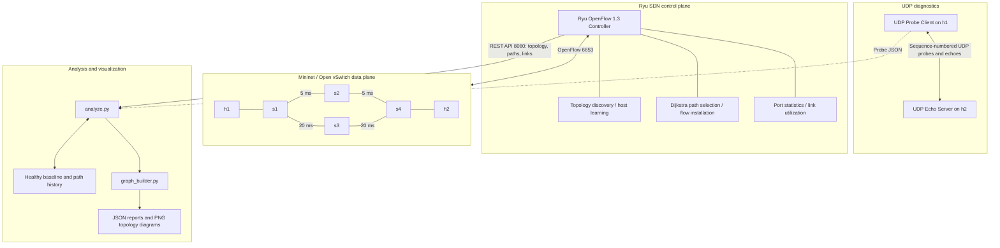
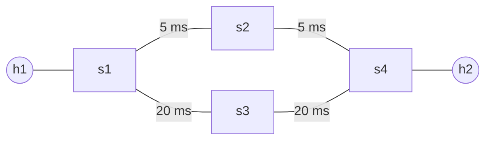

# Network Diagnostic and Path Analysis Tool

**Computer Networks Project | UDP Sockets · Mininet · Ryu SDN · OpenFlow 1.3**

A socket-based network diagnostic application that measures **round-trip time (RTT), jitter, and packet loss**, discovers an SDN topology, correlates measurements with the **actual forwarding path**, detects link failures, and compares alternate paths.

## Architecture



### Network topology



The four-switch diamond has two candidate routes between `h1` and `h2`:

| Route | Switch path | Typical RTT |
|---|---|---:|
| Upper / normal | `s1 → s2 → s4` | ~20 ms |
| Lower / failover | `s1 → s3 → s4` | ~80 ms |

The inter-switch links are configured for **10 Mbps**. The upper links have **5 ms** delay each; the lower links have **20 ms** delay each. RTT values are observations, not hard guarantees.

## Features

- UDP echo probes with sequence numbers and timestamps
- Minimum, average, and maximum RTT, jitter, and packet-loss measurements
- Ryu LLDP topology discovery and host learning
- OpenFlow path installation with Dijkstra's algorithm
- Port-statistics collection and utilization-aware routing costs
- Healthy-topology baseline comparison for failed-link and failed-path detection
- Path history and comparison of previously probed routes
- Network graphs highlighting active paths and failures
- JSON reports for each experiment

## Project structure

```text
cn_project/
├── sdn/
│   ├── diag_controller.py    # Ryu controller and REST endpoints
│   ├── topo_diamond.py       # Mininet topology
│   ├── run_all.sh            # Launch and cleanup
│   └── check_rest.py         # Controller / topology health check
├── sockets/
│   ├── client.py             # UDP diagnostic client
│   └── server.py             # UDP echo server
├── integration/
│   ├── analyze.py            # Probe + live topology correlation
│   ├── graph_builder.py      # Topology visualization
│   └── graph_test.py         # Graph integration test
├── results/                  # Generated JSON and PNG outputs
└── README.md
```

## Prerequisites

- Linux / Ubuntu, or WSL configured to support Mininet and Open vSwitch
- Mininet and Open vSwitch
- Python 3 with `networkx` and `matplotlib`
- Ryu installed in a Python virtual environment at `~/ryuenv` (or specify `RYU_VENV`)
- Available TCP ports **6653** (OpenFlow) and **8080** (Ryu REST API)

The launcher expects an executable `~/ryuenv/bin/ryu-manager` by default. Install/configure the dependencies for your Linux environment before proceeding.

## Run from scratch

Use **two terminals**. Terminal 1 runs Mininet; Terminal 2 runs the analysis commands. Unless otherwise stated, commands start in the `cn_project` directory.

### 1. Clean previous state

Exit any running `mininet>` session first, and stop the old launcher with `Ctrl+C`.

```bash
cd ~/cn_project  # adjust to your actual location
sudo mn -c
rm -f results/probe*.json results/merged_*.json results/history.json results/*.png
```

This preserves `results/baseline_topology.json`. The normal-state analysis below **refreshes** it using `--save-baseline`; only do this while all network links are healthy. `run_all.sh` also cleans stale Mininet state and Ryu processes before launching.

### 2. Start the controller and topology — Terminal 1

```bash
cd ~/cn_project
./sdn/run_all.sh
```

Wait for `*** READY` and the `mininet>` prompt. Keep Terminal 1 open. Start the UDP echo server **inside Mininet**:

```text
h2 python3 sockets/server.py --port 5005 &
```

### 3. Check controller connectivity — Terminal 2

```bash
cd ~/cn_project
python3 sdn/check_rest.py
cd integration
```

The check verifies switches, directed links, hosts, path information, and metrics. Run all subsequent `analyze.py` commands from `cn_project/integration/` in Terminal 2.

> **Command prompt note:** Commands shown under **Mininet** are typed at `mininet>` *without* typing the prompt itself. Commands under **Terminal 2** run in a normal Linux shell.

## Experiments

### A. Normal operation

**Mininet (Terminal 1):**

```text
h1 ping -c 3 h2
h1 python3 sockets/client.py --dst 10.0.0.2 --count 100 --out results/probe_normal.json
```

**Terminal 2 (`integration/`):**

```bash
python3 analyze.py \
  --probe ../results/probe_normal.json \
  --save-baseline \
  --out ../results/normal.png \
  > ../results/merged_normal.json
```

Expected: active route `h1 → s1 → s2 → s4 → h2`, RTT around **20 ms**, and status `OK` under healthy conditions. This saves a fresh healthy topology baseline.

### B. Link failure and automatic failover

**Mininet:**

```text
link s2 s4 down
h1 ping -c 3 h2
h1 python3 sockets/client.py --dst 10.0.0.2 --count 100 --out results/probe_failure.json
```

Allow a few seconds for link discovery and flow updates.

**Terminal 2:**

```bash
python3 analyze.py \
  --probe ../results/probe_failure.json \
  --out ../results/failed_s2s4.png \
  > ../results/merged_failed.json
```

Expected: `s2–s4` is reported as failed, the former upper path is flagged as failed, and traffic is rerouted through `s1 → s3 → s4` at roughly **80 ms RTT**. The analysis status is `REROUTED_AFTER_FAILURE`.

### C. Link restoration and recovery

**Mininet:**

```text
link s2 s4 up
h1 ping -c 3 h2
h1 python3 sockets/client.py --dst 10.0.0.2 --count 100 --out results/probe_recovery.json
```

**Terminal 2:**

```bash
python3 analyze.py \
  --probe ../results/probe_recovery.json \
  --out ../results/recovery.png \
  > ../results/merged_recovery.json
```

**How recovery works in this implementation:** The Ryu controller detects the topology change, **clears installed flows**, and recomputes a route when packets arrive. Both routes have the same hop count; at negligible utilization, the Dijkstra implementation processes neighbors in sorted order, normally choosing **s2 before s3**. The expected low-load recovery route is therefore `s1 → s2 → s4`, with RTT returning to approximately **20 ms**, as shown in the captured recovery run. This is **not a latency-based guarantee**: utilization-sensitive path costs can affect the selected route.

### D. Packet-loss injection

First check the **active** path in a normal shell:

```bash
curl http://127.0.0.1:8080/v1.0/diag/paths
```

Apply loss to an interface on that path. If the active route uses **s3**, use the lower-path interface `s1-eth3`:

**Mininet:**

```text
sh tc qdisc change dev s1-eth3 parent 5:1 handle 10: netem delay 20ms loss 20%
h1 python3 sockets/client.py --dst 10.0.0.2 --count 100 --out results/probe_loss.json
sh tc qdisc change dev s1-eth3 parent 5:1 handle 10: netem delay 20ms loss 0%
```

If the active route uses **s2**, substitute `s1-eth2` and `delay 5ms` in **both** `tc` commands. Verify the actual interface mapping and existing `tc` hierarchy before changing it. Always restore the loss setting after the experiment.

**Terminal 2:**

```bash
python3 analyze.py \
  --probe ../results/probe_loss.json \
  --out ../results/loss.png \
  > ../results/merged_loss.json
```

The observed loss may differ from the configured **20%**. When measured loss is **greater than 10%**, the analyzer reports `DEGRADED`. If the probe reports **0%**, verify that loss was applied to the active path; zero loss alone does not demonstrate successful injection.

> Run each analysis promptly after its corresponding probe (ideally within about two minutes), because stale probes may produce warnings.

## Example results

These values are from the supplied project run; they are illustrative rather than fixed outputs.

| Scenario | Active switch path | Average RTT | Packet loss | Analysis status |
|---|---|---:|---:|---|
| Normal | `s1 → s2 → s4` | 20.501 ms | 0% | `OK` |
| `s2–s4` down | `s1 → s3 → s4` | 80.508 ms | 0% | `REROUTED_AFTER_FAILURE` |
| Recovered | `s1 → s2 → s4` | 20.476 ms | 0% | `OK` |

The supplied `probe_loss.json` records **0% observed loss** in that particular run. The packet-loss feature and injection procedure are implemented, but a live nonzero-loss run is needed if you want an example demonstrating `DEGRADED` in the repository.

### Generated outputs

| File | Description |
|---|---|
| `results/probe_*.json` | Probe counts, RTT, jitter, and packet loss |
| `results/merged_*.json` | Correlated path, topology, link failure, and status data |
| `results/history.json` | Latest recorded measurements for probed paths |
| `results/baseline_topology.json` | Healthy topology snapshot for failure detection |
| `results/normal.png` | Normal path visualization |
| `results/failed_s2s4.png` | Failed link and failover visualization |
| `results/recovery.png` | Restored-link visualization |
| `results/loss.png` | Packet-loss scenario visualization |

Inspect the output files with:

```bash
ls -lh results/
```

## How routing and failure detection work

1. **Topology discovery:** Ryu observes LLDP link events and learns host attachment points.
2. **Path selection:** Dijkstra selects a route using the edge cost `1 + 100 × utilization²` (not RTT).
3. **Forwarding:** The controller installs OpenFlow rules for the selected path.
4. **Probing:** The UDP client sends sequence-numbered packets and computes RTT, jitter, and loss from the echoes.
5. **Correlation:** `analyze.py` queries Ryu REST endpoints for switches, links, hosts, active paths, and utilization data.
6. **Failure analysis:** Live links are compared with `baseline_topology.json`; missing links and affected baseline paths are flagged.
7. **Visualization:** The graphing module draws the active route and highlights failed or degraded conditions.

The analyzer uses status values `OK`, `DEGRADED`, `REROUTED_AFTER_FAILURE`, and `NO_PATH`.

## Troubleshooting

| Symptom | What to check |
|---|---|
| `ryu-manager not found` | Confirm the virtual environment at `~/ryuenv` or set `RYU_VENV` |
| REST API unavailable | Check `sdn/logs/ryu.log` and whether port 8080 is free |
| Missing switches/hosts | Wait for discovery; run `h1 ping -c 3 h2`, then rerun `sdn/check_rest.py` |
| Missing failed-link detection | Ensure the healthy baseline was saved **before** taking a link down |
| Unexpected path | Inspect `http://127.0.0.1:8080/v1.0/diag/paths` and current link utilization |
| 0% loss after injection | Check the active interface and whether `tc` modified its actual queueing discipline |
| Stale-probe warning | Re-run the probe and immediately re-run `analyze.py` |

## Limitations and future improvements

- Route selection is based on hop cost and utilization, **not directly on latency**.
- Path comparison uses measurements of routes that have actually been probed.
- Failed-link detection requires a previously saved healthy baseline.
- The provided demonstration targets one host pair and a four-switch topology.
- Future work could include latency-aware routing, automated periodic probes, and larger multi-host topologies.

## Shutdown

At the `mininet>` prompt:

```text
exit
```

The launcher then stops its Ryu process and cleans Mininet. Avoid running `sudo mn -c` while the network is active.
